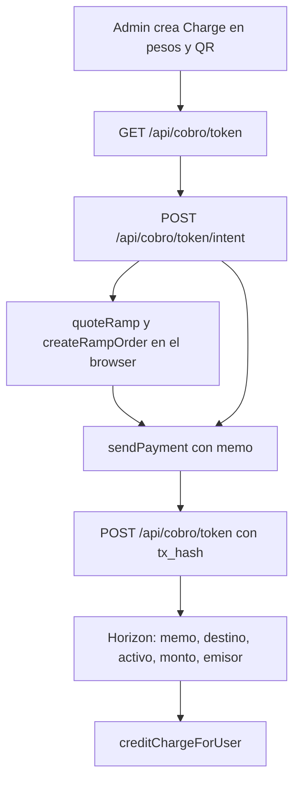

# Cobros con Pollar — documentación técnica

Estado al 11 de noviembre de 2026. Cubre la liquidación de un `Charge` de Tonki: pago en cripto desde la wallet Pollar del cliente y carga en pesos (onramp) hacia esa misma wallet. El detalle del registro que el onramp puede exigir antes de cotizar está en [`RAMP_REGISTRO.md`](./RAMP_REGISTRO.md).

## Decisión

Pollar Pay (`POST /v2/charges`, una wallet pool del negocio) no se puede usar: el producto responde `BRANCH_NOT_FOUND` y está marcado como coming soon. La rampa v2 (`createOnRamp` con `walletAddress` del negocio) ya no existe en `@pollar/core` 0.12.

El cobro se liquida así:

1. El servidor bloquea activo, monto, destino y memo (`PaymentIntent`).
2. El cliente paga con `sendPayment` a la `wallet_address` del admin del negocio.
3. Tonki verifica la transferencia en Horizon y solo entonces acredita Tonkis.
4. Si no tiene saldo, un onramp 0.12 deposita el activo en **su** wallet. Al terminar, el mismo `sendPayment` paga al negocio. No hay un segundo pago automático.

Cashback, líneas del ticket y CRM siguen en Tonki. Pollar no calcula Tonkis.

## Flujo

La sesión que habla con Pollar es la del browser (`usePollar` / DPoP). El servidor de Tonki no llama a Pollar para cotizar, crear la orden ni firmar.

## Superficies

| Pieza | Rol |
|---|---|
| `app/(app)/cobro/[token]/page.tsx` | Preview del ticket. Muestra `PollarPayActions` si `can_claim` y Pollar está listo. |
| `PollarPayActions.tsx` | Bloquea el intent, `sendPayment`, guarda el hash en `sessionStorage` (`tonki:cobro-tx:{token}`) y reintenta el settle. |
| `RampLoadCard.tsx` | Ruta MXN/Stellar, cotización `denomination: "out"`, `payee`, orden, `pendingAction`, polling. |
| `POST /api/cobro/[token]/intent` | `lockPaymentIntent`. |
| `GET /api/cobro/[token]` | Preview. `ramp_order_id` solo se devuelve al pagador que bloqueó el cobro. |
| `POST /api/cobro/[token]` | Body `{ tx_hash }`. `settleChargePayment`. `202 { retry: true }` mientras Horizon no ve la tx. |
| `POST /api/cobro/[token]/ramp` | Body `{ order_id, state }`. Solo id y estado. |

Módulos en `src/lib/charges/settlement/`:

| Archivo | Responsabilidad |
|---|---|
| `config.ts` | Activo, red, Horizon, memo `tonki-` + 16 hex. |
| `rate.ts` | Pesos por unidad. `PAYMENT_MXN_PER_ASSET` o CoinGecko, caché 60 s. `assetAmountForPesos` redondea hacia arriba a 7 decimales. |
| `intent.ts` | Primer pagador gana. Destino = `charge.admin.wallet_address`. Escribe `pay_*` con `updateMany` donde `pay_payer_user_id` es null. |
| `horizon.ts` | Lee la tx y sus pagos. Razones: `not_found`, `failed`, `memo_mismatch`, `no_matching_payment`, `underpaid`, `unavailable`. |
| `settle.ts` | Hash válido, verificación, `pay_status = confirmed`, luego crédito. Conflicto de unicidad → 409. Si ya está confirmado, solo reintenta el crédito. |
| `ramp.ts` | Elección de ruta, vista de la orden, `describeNoQuote`. Sin red. |
| `rampOrder.ts` | Persistencia del id. Solo el pagador, cobro pendiente. Una orden nueva reemplaza la guardada solo si la anterior está `failed` o `refunded`; si no, 409. |

El gate de crédito está en `creditCharge.ts`: acredita solo con `pay_status = confirmed` y `pay_payer_user_id` igual al usuario. Un pago confirmado se puede acreditar aunque el código haya vencido. Otro pagador, o un negocio sin wallet Stellar válida, no puede cobrar (`preview.claimAvailability`).

## Datos en `Charge`

Migraciones `20261111120000_charge_onchain_settlement` y `20261111140000_charge_ramp_order`, aplicadas en la base de Hostinger.

| Columna | Uso |
|---|---|
| `pay_asset_code`, `pay_asset_issuer`, `pay_amount`, `pay_rate_mxn` | Activo y monto bloqueados. |
| `pay_destination`, `pay_memo`, `pay_network` | A dónde y con qué memo. `pay_memo` único. |
| `pay_payer_user_id`, `pay_status` | `awaiting` o `confirmed`. |
| `pay_tx_hash`, `pay_confirmed_at` | Tx verificada. `pay_tx_hash` único. |
| `ramp_order_id`, `ramp_order_state` | Reanudar con `getRampOrder`. Único el id. |
| `created_by_staff_id` | Mesero que generó el QR (`POST /api/staff/charges`). Null si lo generó el negocio. `admin_id` sigue siendo el dueño, así que destino y CRM no cambian. Migración `20261117160000_staff_waiters`. |

No se persisten CLABE, QR, referencia ni respuestas de KYC.

## Qué comprueba Horizon

Para confirmar, la tx tiene que cumplir todo esto:

- Memo de texto igual a `pay_memo`.
- Pago al `pay_destination`.
- Mismo activo que el intent (XLM nativo o `code` + `issuer`).
- Suma de pagos que coinciden ≥ `pay_amount`.
- Emisor filtrado cuando el intent trae pagador.

`not_found` y `unavailable` no fallan el cobro: el cliente recibe 202 y reintenta (hasta 24 veces, cada 2.5 s, más un botón de verificar).

## Configuración

| Variable | Efecto |
|---|---|
| `PAYMENT_ASSET` | `native` / `XLM` (default) o `CODE:ISSUER`. Lo decide el servidor. |
| `PAYMENT_MXN_PER_ASSET` | Fija el tipo de cambio. Sin ella, CoinGecko (XLM, USDC, EURC). |
| Red Pollar | `readPollarNetwork()` elige Horizon testnet o mainnet. |
| `HORIZON_URL` | Sustituye el Horizon de esa red. |

El admin del negocio necesita `wallet_address` que cumpla `^G[A-Z2-7]{55}$`. Si no, el cobro se bloquea con “El negocio aún no tiene una wallet para recibir pagos.” El formulario de alta todavía no avisa eso antes de generar el QR.

La cotización del ramp usa el `amount` ya bloqueado con `denomination: "out"`. Los pesos que ve el cliente (`amountIn`) son los de Pollar, no un recálculo de CoinGecko. La ruta es ONRAMP, fiat MXN / país MX, activo Stellar del intent; si hay varias, gana el rail `SPEI`.

Matching del activo: XLM solo con `identifier` vacío. Un activo emitido exige `identifier` igual al issuer o `CODE:ISSUER`. Código sin issuer no hace match.

## Onramp en la tarjeta

Implementado en `RampLoadCard`:

- `getRampRoutes("ONRAMP")` → `pickOnrampRoute`.
- `quoteRamp` → campos `rampQuoteFields` → `createRampOrder({ quoteId, payee })`. El mismo `quoteId` devuelve la misma orden.
- `pendingAction`: transferencia o QR (`FIAT_PAYMENT`), link o `openKycModal` (`KYC`), botón Autorizar con `signRampLeg` (`SIGNATURE`), `openCosignModal` (`COSIGN_APPROVAL`).
- `pollRampOrder` hasta `completed`, `failed` o `refunded`. Al desmontar se aborta.
- Al completar, se refresca el saldo y el botón de wallet sigue siendo el único que envía dinero. Mientras el paso de ramp está activo, ese botón queda deshabilitado; “Dejar de esperar” lo vuelve a habilitar.
- Firma: no hay signer de ramp en core. Durante el clic de Autorizar se registra un handler `STELLAR` / `xdr` y se suelta al terminar.
- Sin ruta: mensaje y el pago con saldo sigue disponible. En testnet es habitual que el dashboard no tenga corredores.

## Registro del corredor — no implementado

Antes de devolver una cotización, el corredor puede exigir, en orden, `KYC`, `FORM`, `REGISTRY_CHECK` y `PROVIDER_REGISTRATION`. El cobro solo abre el modal de KYC y la trustline. Formulario, padrón y alta con el proveedor se quedan en un texto genérico. Contrato, errores y punto de enganche: [`RAMP_REGISTRO.md`](./RAMP_REGISTRO.md).

Tampoco están cableados `create_wallet`, `set_up_wallet`, `migrate_custody` ni `set_up_recovery` (`rampWalletStep`).

## Fuera de alcance

- Pollar Pay y pool wallets.
- Offramp y que el onramp pague directo al negocio (0.12 no acepta `walletAddress` de destino en `createRampOrder`).
- Webhook de Pollar. La confirmación es Horizon, no un status de charge.
- Aviso de wallet en el formulario de venta.
- Ramp genérico de depositar/retirar en `/account`.

## Pruebas y operación

Helpers de ruta, vista de orden, registro de `ramp_order_id`, Horizon, tipo de cambio, settle y crédito tienen tests de vitest sin red. No hay prueba de browser con sesión Pollar real: hace falta un usuario autenticado, un corredor MXN habilitado en dashboard.pollar.xyz y una wallet de negocio en la misma red.

Al desplegar, el build tiene que incluir estas rutas. La base de Hostinger ya tiene las columnas. En esa base siguen registradas cuatro migraciones que no están en este repo (`20260804140000_airdrop_asset_usdc_default`, `20260805010000_establishment_phone_hours`, `20260811140000_add_waiter_bill_qr`, `20260811210000_waiter_bill_tonkis_awarded`); `migrate deploy` de estas dos pasó, pero `migrate dev` en otro clon puede chocar con ese historial.
