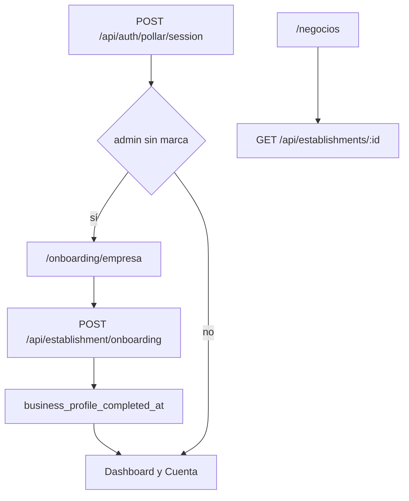
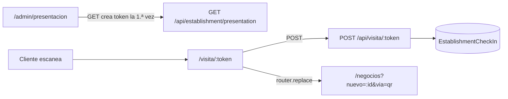

# Perfil de empresa, perfiles y lugares

Estado al 17 de noviembre de 2026. Cubre el alta obligatoria de una cuenta de empresa, la ficha pública que ve el cliente, el rediseño de las pantallas de perfil y la página de lugares. Los cobros con Pollar siguen en [`COBROS_POLLAR_TECNICO.md`](./COBROS_POLLAR_TECNICO.md).

## Decisión

Una empresa entra con Pollar igual que un cliente. La diferencia es lo que pasa justo después del primer ingreso.

Si la cuenta es `admin` y `business_profile_completed_at` es null, Tonki no la deja usar la app. La manda a `/onboarding/empresa` y ahí se queda hasta que guarda la ficha pública. Ese formulario se contesta una sola vez. Después, los mismos datos se editan en Cuenta.

Un cliente (`type = user`) nunca ve esa pantalla. Una empresa que ya tenía nombre, categoría, descripción, dirección, teléfono y al menos un día de horario abierto quedó marcada como completa por la migración: no vuelve a pasar por el alta.

La ficha que se guarda es la que se pinta en Lugares. No hay un segundo perfil “interno”.

## Flujo

Tres sitios aplican el mismo predicado `requiresBusinessProfile`:

| Sitio | Qué hace |
|---|---|
| `POST /api/auth/pollar/session` | Si falta el perfil, `redirectTo` es `/onboarding/empresa` e ignora `from`. La respuesta lleva `requiresBusinessProfile: true`. |
| `app/(app)/layout.tsx` y `app/admin/layout.tsx` | `redirectIfBusinessProfileMissing`. Sin sesión no redirige, así que `/negocios` sigue siendo público. |
| `middleware.ts` | `/onboarding/empresa` exige cookie de sesión. El rol y “¿ya completó?” se resuelven en la página, no en el middleware. |

La página del alta redirige a `/admin/dashboard` si la marca ya existe, y a `/dashboard` si la sesión no es de empresa.

## Alta

`BusinessOnboardingClient` reutiliza `BusinessProfileSection` con `mode="onboarding"`. Al guardar llama a `POST /api/establishment/onboarding` y, si responde bien, entra al panel.

El esquema de edición (`establishmentUpsertSchema`) deja categoría, descripción, dirección, teléfono y horario opcionales. El de alta (`establishmentOnboardingSchema`) los exige, y además al menos un día abierto (`hasOpenHours`). Logo, sitio web y coordenadas siguen siendo opcionales. El cashback por defecto es 5, entre 1 y 100.

La ruta solo acepta un admin activo que todavía no tenga la marca. Dentro de una transacción:

1. `updateMany` donde `business_profile_completed_at` es null. Si no actualiza ninguna fila, responde 409 y no escribe el establecimiento.
2. Si ya había un `Establishment` de ese admin, lo actualiza. Si no, lo crea.

Un segundo envío, o dos envíos a la vez, no pueden completar el alta dos veces. La galería no está en esta pantalla: aparece en Cuenta cuando el negocio ya existe.

## Datos

Migración `20261111150000_business_profile_completed`, aplicada en la base de Hostinger. Sin esa columna el login con Pollar devolvía “Error de autenticación: error interno”: Prisma leía `User` completo (`P2022`) al vincular la identidad.

| Columna | Uso |
|---|---|
| `User.business_profile_completed_at` | Null = el alta sigue pendiente. Con fecha = ya no se vuelve a pedir. |

La ficha pública vive en `Establishment` (migración `20261025170000_establishment_public_profile`) y en `EstablishmentImage`:

| Campo | En la ficha |
|---|---|
| `name`, `category`, `description`, `avatar_url` | Nombre, categoría, texto y logo. |
| `address`, `phone`, `website` | Contacto. Teléfono abre `tel:`. El sitio se abre en otra pestaña. |
| `hours` | JSON de la semana, o texto libre viejo si no empieza por `{`. |
| `location_x`, `location_y`, `location_z` | Longitud, latitud y altura en metros. Con X e Y hay enlace a OpenStreetMap. |
| `cashback_percent` | Porcentaje de Tonkis que muestra la ficha. |
| `EstablishmentImage` | Hasta 8 fotos. La primera es la portada. Orden por `sort_order`. |

`hours` estructurado es un objeto `mon`…`sun` con `{ closed, open, close }`. “Abierto ahora” se calcula en el navegador, con la hora del visitante, y se refresca cada minuto. Un cierre anterior a la apertura cuenta como horario que cruza la medianoche.

## Lugares

`/negocios` lista todos los establecimientos. No filtra por perfil completo: un negocio viejo sin ficha también aparece.

| Pieza | Rol |
|---|---|
| `app/(app)/negocios/page.tsx` | Carga el directorio. Si hay `?lugar=`, precarga esa ficha. Las visitas solo se consultan con sesión de cliente. |
| `PlacesHive.tsx` | Panal, búsqueda y puentes entre visitados. |
| `PlacesDirectory.tsx` | Abre la ficha en un diálogo. Escribe `?lugar=` sin recargar. Escape o el fondo cierran y vuelven a `/negocios`. |
| `PublicEstablishmentView.tsx` | Portada, logo, cashback, abierto/cerrado, llamar, cómo llegar, horario y fotos. |
| `GET /api/establishments/[id]` | Ficha pública. Sin sesión. Id de más de 36 caracteres o inexistente → 404. |
| `/negocios/[id]` | Redirige a `/negocios?lugar=`. |

Una visita es un **día distinto** (hora de `America/Mexico_City`) en el que el usuario tuvo un `Charge` acreditado en ese lugar **o** escaneó su QR de presentación (`EstablishmentCheckIn`). `listVisitedEstablishments` lee ambos y los une con `mergeVisitEvents` (`src/lib/establishment/presentation.ts`). Antes contaba cobros, no días: dos consumos el mismo día ahora son una visita.

El panal ordena así, solo para un cliente con sesión:

1. Visitados primero, por número de visitas y luego por la más reciente.
2. El resto, por nombre.

Esos visitados quedan en el centro. Si dos celdas visitadas son vecinas en la grilla hexagonal, se dibuja un puente entre ellas. La búsqueda no esconde celdas: atenúa las que no coinciden en nombre, categoría o dirección.

La grilla es una espiral axial mientras quepa con celdas de al menos 96 px. Si el ancho no alcanza, pasa a filas desplazadas. El anillo exterior se rellena con celdas vacías para que el panal no quede mordido.

## QR de presentación

Un QR fijo por negocio para el mostrador. A diferencia del QR de consumo, no tiene monto ni vence y no acredita Tonkis: solo registra que el cliente estuvo ahí.

| Pieza | Rol |
|---|---|
| `Establishment.presentation_token` | 24 caracteres base64url, único. Null hasta que el negocio abre su QR. |
| `EstablishmentCheckIn` | `user_id`, `establishment_id`, `day` (YYYY-MM-DD CDMX). Único en `(user_id, establishment_id, day)`. |
| `GET /api/establishment/presentation` | Admin activo. Crea el token si falta (`updateMany` con `presentation_token: null`, así dos pestañas no generan dos) y devuelve `url` y `qr_image` (720 px, corrección Q). |
| `POST /api/establishment/presentation` | Rota el token. El QR anterior, impreso o no, deja de funcionar. |
| `POST /api/visita/[token]` | `requireActiveClientSession`. 201 si suma visita; 200 con `already_today: true` si ya escaneó hoy (choque `P2002`). 404 si el token no existe o se rotó. 403 si el dueño escanea su propio negocio. |
| `/visita/[token]` | En `middleware.ts` (pide sesión). Hace el POST una vez por token, saluda y redirige al panal tras ~1 s. |

Un mesero que escanea queda en `/mesero` por el middleware. Una empresa recibe el 403 de `requireActiveClientSession`.

Migración `20261117190000_establishment_presentation_qr`. **Pendiente de aplicar en Hostinger** con `npx prisma migrate deploy`.

## Animación de llegada al panal

`PlacesHive` anima cada visita nueva. Hay dos fuentes y se unen en `planHiveArrivals` (`src/lib/establishment/hiveArrivals.ts`, con pruebas):

1. **Explícita.** `?nuevo=<id>&via=qr|consumo[&hoy=1]`, que ponen `/visita/[token]` y el botón “Ver tu colmena” del cobro acreditado. Si el cliente entra por la barra, la misma llegada se lee de `localStorage` (`tonki:hive:pending`), que también enciende un punto en Lugares de `BottomNavbar`.
2. **Por diferencia.** `localStorage` guarda por cliente (`tonki:hive:seen:<userId>`) cuántas visitas vio animarse por lugar. Al abrir el panal, cualquier lugar con más visitas que las guardadas se anima con `via: "consumo"`. Sin registro previo no se anima nada: la primera carga no es novedad.

Máximo tres llegadas, una tras otra. `PlacesDirectory` limpia `?nuevo=` de la URL para que recargar no la repita.

| Tipo | Qué se ve |
|---|---|
| Celda nueva | El panal se oscurece, el hueco destella, la celda vuela en arco desde arriba girando y aterriza. Al tocar: se enciende en dorado, ondas hexagonales, chispas de miel, “¡Nuevo!”, puentes con vecinos visitados que crecen y el contador “Visitados” sube. |
| Visita más | Rebote con brillo, ondas y “+1 visita”. |
| Mismo día | Rebote suave y “Hoy ✓”. |

Arriba del panal sale un aviso con el nombre y un botón “Ver” que abre la ficha. Con `prefers-reduced-motion` no hay vuelo ni chispas, solo el cambio de celda y el aviso. `localStorage` va en `try/catch`: sin él, el panal funciona y solo pierde la detección por diferencia.

## Perfiles

Misma piel (cromo, acento, panal de fondo) en tres sitios. Los datos que cada uno muestra no cambiaron de contrato.

| Superficie | Quién la ve | Qué enseña |
|---|---|---|
| `/account` | La sesión | Cabecera con foto, rol y wallet (se puede copiar). Empresa: ficha del negocio y accesos a panel, CRM y QR. Cliente: saldo de Tonkis y movimientos recientes (`GET /api/account/tonkis`), y después los datos personales. |
| `UserProfileModal` | Quien abre a alguien desde el feed | Nombre, foto, “en Tonki desde” y, si es empresa, un enlace a su lugar. Sale de `GET /api/users/:id` → `loadPublicUserProfile`. No lleva correo, wallet ni fecha de nacimiento. |
| Diálogo de `/negocios` | Cualquiera | La ficha pública completa. Si el visitante ya acreditó consumos ahí, el diálogo dice cuántas veces. |

La foto de perfil del usuario se elige en la cabecera y se guarda con el formulario personal (JPG, PNG, GIF o WebP, 2 MB). La galería del negocio es aparte: `POST /api/establishment/images` y `DELETE /api/establishment/images/:id`.

## Qué no hace

- No pide la ficha en cada login. La marca es permanente.
- No obliga a subir logo, sitio, mapa ni fotos para entrar.
- No avisa, en el alta, si la empresa todavía no tiene wallet Stellar. Sin esa wallet el cobro sigue bloqueado; ver [`COBROS_POLLAR_TECNICO.md`](./COBROS_POLLAR_TECNICO.md).
- No oculta en Lugares a un negocio incompleto que ya existía antes de esta marca.
- No cuenta como visita un cobro pendiente. Solo uno ya acreditado o un escaneo del QR de presentación.
- El QR de presentación no da Tonkis ni sirve para dinámicas. No comprueba que el cliente esté físicamente en el local: si el código se filtra, se rota.
- El alta no sube la galería. Eso queda para Cuenta.

## Pruebas

`src/lib/auth/businessProfile.test.ts` cubre el predicado: empresa sin marca, empresa con marca, cliente.

`src/lib/establishment/presentation.test.ts` cubre el día CDMX, la unión de visitas, el check-in (token inválido, rotado, dueño, primera visita, mismo día) y la creación y rotación del token. `hiveArrivals.test.ts` cubre qué llegadas se animan.

`src/lib/establishment/onboardingRoute.test.ts` cubre el POST: guarda y marca, rechaza un segundo envío (409), rechaza la carrera que pierde el `updateMany` (409) y rechaza un teléfono vacío (400) sin tocar la base.
