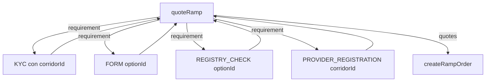

# Registro del ramp (lo que el cobro todavía no hace)

Anexo de [`COBROS_POLLAR_TECNICO.md`](./COBROS_POLLAR_TECNICO.md). El resumen para dirección está en [`COBROS_POLLAR.md`](./COBROS_POLLAR.md).

Un onramp MXN de Pollar 0.12 puede negarse a cotizar hasta que el usuario termine una cadena de pasos del corredor. Esos pasos viven en la sesión Pollar del navegador (DPoP). Tonki no los guarda y no debe guardarlos: ni respuestas de formularios, ni identidad, ni el consentimiento.

El cobro (`RampLoadCard` + `describeNoQuote` en `src/lib/charges/settlement/ramp.ts`) solo reacciona a dos bloqueos previos a la cotización:

| Bloqueo | Qué hace hoy |
|---|---|
| `requirement.type === "KYC"` con botón en `rampRequirementCopy` | Abre `openKycModal({ corridorId })` y vuelve a cotizar |
| `failure.resolutionAction === "add_trustline"` | `setTrustline({ code, issuer })` y vuelve a cotizar |

Si el corredor pide **formulario**, **padrón** o **registro con el proveedor**, la cotización vuelve en `rejected` y la tarjeta muestra un texto genérico. No hay pantalla para completar esos pasos, así que el usuario no puede llegar a la orden.

Los campos de `rampQuoteFields(quote)` (nombre, CLABE, etc.) son otra cosa: solo aparecen **después** de una cotización aceptada y viajan en `payee` al crear la orden. No sustituyen el registro.

## Cuándo aparece

`POST /ramps/quotes` no devuelve `quotes`. La ruta queda en `rejected[]` con `requirement`:

```ts
{
  corridorId: string;   // se reusa en cada llamada de este corredor
  position: number;     // primer paso pendiente
  completed: number;
  total: number;
  type: "KYC" | "FORM" | "REGISTRY_CHECK" | "PROVIDER_REGISTRATION";
  optionId: string;     // formId, opción de KYC o de padrón
  status: "none" | "pending" | "rejected" | "expired";
  reviewReason?: string;
}
```

Los pasos van **en orden**. Se completa el primero pendiente y se vuelve a llamar `quoteRamp`. Pollar no adelanta el siguiente.

`rampRequirementCopy` (SDK) dice qué botón corresponde. Tonki hoy solo usa el caso KYC:

| `type` | `status` | Texto del SDK | Botón |
|---|---|---|---|
| `FORM` | cualquiera | Answer a few questions to see this route | Continue |
| `PROVIDER_REGISTRATION` | cualquiera | Register with the provider to see this route | Continue |
| `REGISTRY_CHECK` | distinto de `pending` | Confirm your details to see this route | Confirm |
| `REGISTRY_CHECK` | `pending` | Your details are under review | ninguno |
| `KYC` | `none` / sin `reviewReason` | Verify your identity… | Verify / Continue |
| `KYC` o padrón | `pending` con revisión, o `rejected` | under review / not approved | ninguno |

Si **todas** las rutas rechazadas tienen `action === null`, `describeNoQuote` ya dice que la verificación está en revisión o fue rechazada. Ahí no hay nada que construir.

## Lo que falta implementar

Todo corre en el cliente con `getClient()` de `usePollar()`. Después de un submit exitoso, `quoteRamp` otra vez con el mismo body (`buildQuoteRequest`).

### 1. Formulario — `FORM`

`optionId` es el `formId`.

```ts
const form = await client.getRequirementForm(formId);
// form.fields, form.answers (prefill), form.missing
await client.submitRequirementForm(formId, answers);
```

Campos (`RequirementFormField`): `text`, `textarea`, `number`, `date`, `select`, `multiselect`, `checkbox`, `email`, `phone`. `label` y `help` vienen en `{ en, es }`; en Tonki se muestra `es`. `answers` es un mapa `key → string | number | boolean | string[]`. Hay que mandar el set completo, no un parche.

Error útil: `KYC_FORM_INVALID_ANSWERS` (422). El SDK documenta `body.errors` como `{ key, code }[]`.

### 2. Padrón — `REGISTRY_CHECK`

El SDK lo describe como SEGIP. `optionId` es el de la opción del padrón, no el `corridorId`.

```ts
const check = await client.getRegistryCheck(optionId);
await client.submitRegistryCheck(optionId, {
  surname1,
  surname2,          // opcional
  complementNumber,  // opcional
});
```

`prefill.applies === false` cuando el documento del usuario no es de este padrón: no hay datos que confirmar. Si aplica, el prefill trae `givenNames`, `surname1`, `surname2`, `birthdate`, `dniType` (`CI` | `CE`), `documentNumber` y a veces `complementNumber`. Solo se editan el corte de apellidos y el complemento; el resto sale de la identidad ya verificada (o de un formulario anterior del mismo corredor).

Respuestas del submit: `approved`, `rejected` (con `rejectedFields` corregibles) o `pending` (revisión humana; no reenviar mientras tanto).

Errores:

| Código | Cuándo |
|---|---|
| `KYC_REGISTRY_IDENTITY_REQUIRED` (409) | Falta el KYC anterior |
| `KYC_REGISTRY_NAME_MISMATCH` (422) | Los apellidos no reconstruyen el apellido verificado |
| `SDK_KYC_UNDER_REVIEW` (409) | Ya hay una revisión abierta |

### 3. Registro con el proveedor — `PROVIDER_REGISTRATION`

Este es el alta del usuario en el ramp. No lleva body: el consentimiento es el POST. Antes hay que mostrar qué se comparte.

```ts
const registration = await client.getProviderRegistration(corridorId);
// status: "none" | "registered"
// ready: true solo si los pasos anteriores están completos
// fields: string[]  — lo que se envía al proveedor
// rampProviderId

if (registration.ready && registration.status !== "registered") {
  await client.submitProviderRegistration(corridorId);
}
```

El POST manda la identidad verificada, las respuestas de los formularios y el resultado del padrón. A partir de ahí las órdenes de ese corredor van a nombre de ese usuario.

Errores:

| Código | Cuándo |
|---|---|
| `KYC_REGISTRATION_STEPS_PENDING` (409) | Todavía hay un paso anterior abierto |
| `KYC_REGISTRATION_MISSING_DATA` (422) | Falta un campo. El SDK documenta la lista en `body.missing` |

`status === "registered"` no pide otro alta: se vuelve a cotizar.

El alta de **tarjetas** (`/requirements/card-registration/{cardProviderId}`) es otro producto. El cobro no lo usa.

### KYC (ya hay botón, el paso sigue siendo el primero)

Si `type === "KYC"`, el `optionId` es la opción del paso y `corridorId` acota la sesión. El modal actual (`openKycModal({ corridorId, onApproved })`) cubre el caso con botón. Al aprobar, se cotiza de nuevo. Un `pending` con `reviewReason` no tiene botón: el usuario espera.

## Orden típico de un corredor



Un corredor puede traer un subconjunto. `completed` / `total` dicen en cuál va el usuario. No asumir que México/SPEI siempre pide padrón: SEGIP es el ejemplo del SDK, no una regla de MXN.

## Qué no mezclar

- **Rutas vacías** (`getRampRoutes` sin MXN/Stellar) es configuración de la app en dashboard.pollar.xyz, no un registro del usuario. El copy ya lo dice en `missingOnrampRouteMessage`.
- **Trustline, wallet, recovery, custody** (`add_trustline`, `create_wallet`, `set_up_wallet`, `migrate_custody`, `set_up_recovery`) son `resolutionAction`, no `requirement`. Solo la trustline tiene botón en el cobro. El SDK expone el resto en `rampWalletStep` / `runRampWalletStep`; tampoco está cableado.
- **`pendingAction.kind === "KYC"`** de una orden ya creada es el link del proveedor durante la orden. El registro de arriba ocurre **antes** de que exista `quoteId`.

## Dónde engancharlo

`describeNoQuote` tendría que devolver vistas nuevas (`form`, `registry`, `registration`) con `optionId` o `corridorId`, y `RampLoadCard` pintar el formulario, la confirmación del padrón o la lista de `fields` más el botón de consentimiento. La sesión y el secreto de Pollar se quedan en el browser, igual que la orden.
